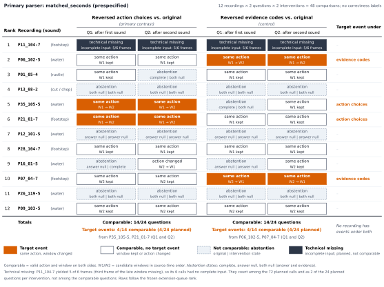

# 扩展批结果论文图

面向论文读者的英文图：12 部视频按冻结扩展队列的入选顺序（`manifest/queue.jsonl` 的 `extension_rank` 1–12）逐行排列，每行展示两问在两项干预（仅换选项、仅换证据代号）下与原顺序比较的四格状态。只用预设主解析 `matched_seconds`；严格解析的敏感性结果见 [结果说明](../../run/participant_extension/results_1124/README.md)，不在本图中。



## 图中分类

每格是一题在一项干预下与原顺序的比较，四类互斥：

| 分类 | 判定 | 仅换选项 | 仅换证据代号 |
| --- | --- | ---: | ---: |
| 目标事件 | 两侧完整，动作相同、物理窗改变（J） | 4 | 4 |
| 可比、未出现目标事件 | 两侧完整，窗不变，或动作改变 | 10 | 10 |
| 因弃答不可比 | 至少一侧弃答（双弃答或只弃答动作），格内写“原顺序 \| 干预”的状态 | 8 | 8 |
| 技术缺失 | P11_104-7 取帧失败，无提示输入，保留在分母中 | 2 | 2 |

两项干预均为可比 14/24、J/C = 4/14。仅换选项的 4 个事件来自 P35_105-5 和 P21_01-7 的两问，仅换证据代号的来自 P06_102-5 和 P07_04-7 的两问，两组视频不重叠。主解析下不存在无效字段、格式错误或代号与秒数冲突；如输入中出现图例未覆盖的不可比状态，脚本会拒绝作图。图中不含模型推理和正确率标注。

## 重建与核对

在仓库根目录运行，只需 Python 3.11 或更高版本和 matplotlib（本次 3.9.0），不需要媒体、模型或网络。

```sh
# 重新生成本目录下的图、作图数据、图注和核对记录
python3 av-occurrence-study/analysis/extension_results_1124/make_extension_figure.py

# 在临时目录重新生成，并与已提交文件逐字节比较
python3 av-occurrence-study/analysis/extension_results_1124/make_extension_figure.py --check
python3 -m unittest discover -s av-occurrence-study/analysis/extension_results_1124 -p 'test_*.py'
```

写出前执行 69 项核对，任一项不符即退出：

- `replies.jsonl`、`attempts.jsonl` 的 SHA-256 与 `statistics.json` 记录一致；`queue.jsonl` 与冻结的 `manifest/fingerprint.json` 一致，`statistics.json` 的视频顺序等于队列顺序。
- 66 条实收回复在 `statistics.json` 中的原文与 `replies.jsonl` 逐条相同；其余 6 个键均为技术缺失。
- 由逐条回复的状态、动作 ID 和物理窗独立重算 48 个比较，逐题与 `statistics.json` 的状态对、可比性、四格和事件一致；每项干预的可比数、四格、J 和不可比状态对与汇总一致。

`statistics.json` 本身由 [`summarize.py`](../../run/participant_extension/results_1124/summarize.py) 从原文重放两种解析得到，复算命令见结果说明。matplotlib 版本不同时 PDF/SVG 可能有字节差异，`--check` 会跳过图文件比较并提示；数据文件仍逐字节核对。

## 文件

| 文件 | 内容 |
| --- | --- |
| `fig_extension_per_recording.pdf` | 矢量图，字体以 TrueType 嵌入 |
| `fig_extension_per_recording.svg` | 同一图的可编辑 SVG，文字保留为文本 |
| `figure_data.csv` | 作图数据：48 行，每行一部视频、一项干预、一问，含两侧状态、分类、四格、动作和物理窗 |
| `figure_totals.csv` | 每项干预的分母、四格、分类计数和目标事件来源 |
| `caption.md` | 英文图注，计数由脚本填入 |
| `verification.json` | 输入 SHA-256、matplotlib 版本和核对清单 |
| `make_extension_figure.py` | 生成源 |
| `test_make_extension_figure.py` | 分类规则和数据输出的离线测试 |
